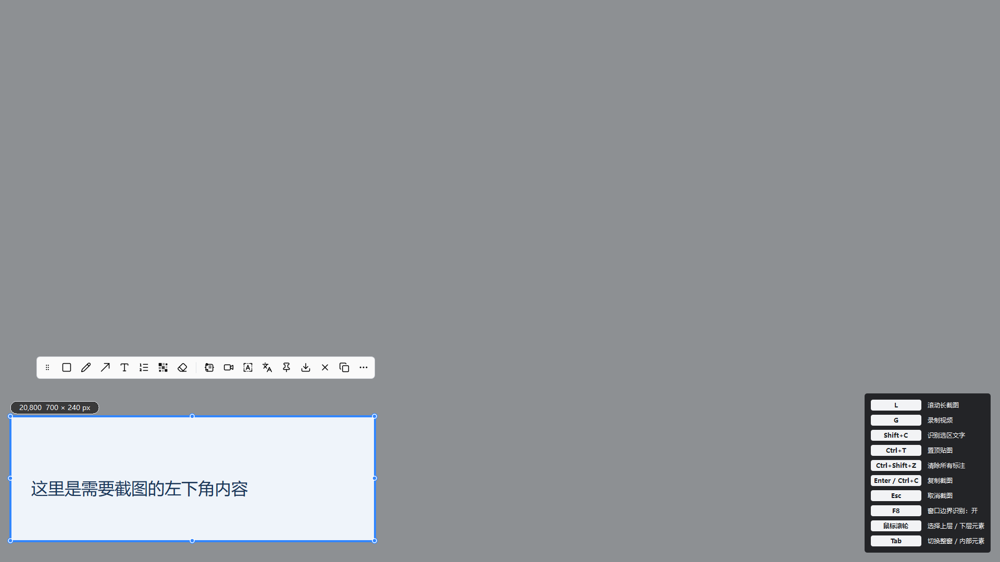
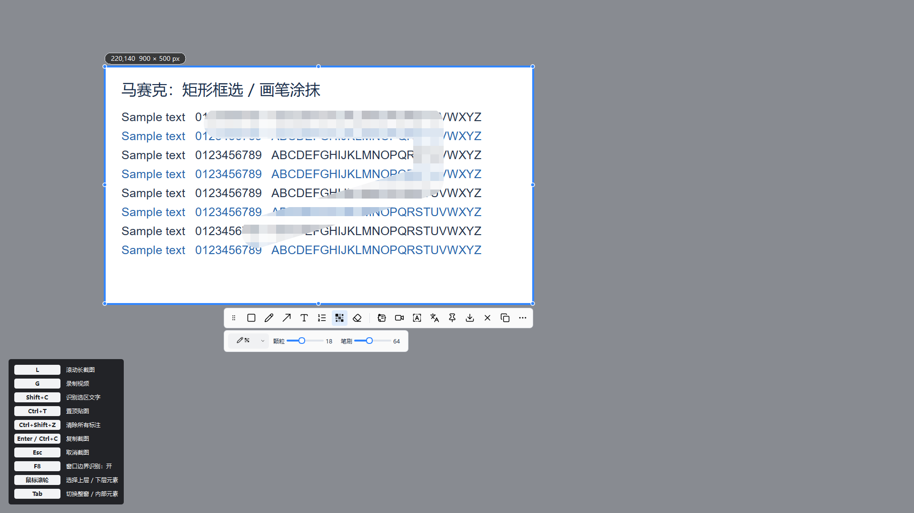

<p align="center"></p>

# 轻截 LightSnip · 免费开源 Windows 截图软件

[](LICENSE)
[](https://github.com/ZiP1824/LightSnip/releases/latest)
[](https://github.com/ZiP1824/LightSnip/releases/latest)

**LightSnip 是一款免费、开源、免登录的 Windows 截图工具。** 支持区域截图、延时截图、滚动长截图、OCR 文字识别、截图标注、桌面贴图、马赛克涂抹、截图翻译、多屏截图和静音录屏。提供绿色版，解压后即可使用，无需安装 Python。

**Free, open-source Windows screenshot tool** with delayed capture, scrolling screenshots, local OCR, annotations, image pinning, mosaic brush, screenshot translation, configurable hotkeys and multi-monitor capture. [English introduction](README.en.md).

**[下载最新版 Windows 绿色版](https://github.com/ZiP1824/LightSnip/releases/latest)** · [功能介绍](https://zip1824.github.io/LightSnip/) · [报告问题](https://github.com/ZiP1824/LightSnip/issues/new/choose)

## 能做什么

| 功能 | 使用方式 |
| --- | --- |
| 区域截图 / 屏幕截图 | 拖动框选；选区内部可整体移动，边缘可调整大小 |
| 延时截图 / 弹窗截图 | 1–60 秒倒计时，先启动再打开弹窗；居中半透明小卡片，四方向缓动避让鼠标 |
| 窗口与内部元素识别 | 悬停预选窗口、控件或文字区域；滚轮切换上下层，Tab 切换整窗 |
| 滚动长截图 / 长图拼接 | 框选后按 L，在选区内滚动；支持纵向、横向及实时预览 |
| 本地 OCR 文字识别 | 提取中英文文字，左图右文，可编辑、复制，识别过程不联网 |
| 截图标注 | 矩形、圆角矩形、椭圆、多种箭头、画笔、荧光笔、文字与序号 |
| 马赛克打码 | 矩形框选或画笔涂抹；笔刷粗细、颗粒大小分别调整 |
| 桌面贴图 / 图片置顶 | 将图片钉在屏幕上，支持拖动、缩放、翻转和透明度 |
| 截图翻译 | 识别后联网翻译，在原文附近显示可复制的小浮层 |
| 多显示器截图 | 各显示器分别框选；复制不要求鼠标留在选区所在屏幕 |
| 静音录屏 | 按选区录制 MP4，10 fps，无音频 |
| 快捷键与设置 | 可自定义全局快捷键，支持开机启动、保存目录记忆 |





## 下载与开始使用

1. 到 [Releases](https://github.com/ZiP1824/LightSnip/releases/latest) 下载 `LightSnip-v0.30-windows-x64.zip`。
2. 解压整个 `LightSnip` 文件夹，运行 `LightSnip.exe`。
3. 默认按 **Ctrl+Shift+1** 开始截图，框选后标注、复制或保存。

请保留程序旁的 `_internal` 和 `ThirdPartyLicenses`，不能只拷贝 EXE。升级时先退出托盘中的旧版本，再启动新版本。首次源码公开版本为 **v0.27**。

## 常用快捷键

| 快捷键 | 操作 |
| --- | --- |
| Ctrl+Shift+1 | 开始截图，可在配置中修改 |
| Ctrl+Shift+2 | 将剪贴板图片贴到桌面 |
| Ctrl+Shift+3 | 打开文字翻译窗口 |
| Ctrl+Shift+4 | 延时截图，可修改；旧用户已保存的绑定保留 |
| Enter / Ctrl+C | 复制当前截图并结束截图 |
| Ctrl+S | 快速保存到记忆目录 |
| Ctrl+T | 置顶贴图 |
| Shift+C | 识别选区文字 |
| L / G | 滚动长截图 / 静音录屏 |
| F8 | 开关自动边界识别，可修改绑定 |
| 鼠标滚轮 / Tab | 切换识别层级 / 切换整窗与内部元素 |
| Ctrl+Z / Ctrl+Y | 撤销 / 重做 |
| Esc | 取消截图 |

## 延时截图：先倒计时，再打开弹窗

托盘右键选择「延时截图」，或在「配置 → 截图」点击「开始延时截图」。默认倒计时 3 秒，可设置为 1–60 秒；时间到后进入框选，不会自动保存。

居中的半透明小卡片带阴影，鼠标从右/左/上/下靠近时，分别以先快后慢的动画移到左/右/下/上边缘。提示不抢焦点、点击穿透；截图前先停止动画并隐藏提示。快捷键在「快捷键/动作 → 延时截图」修改，倒计时期间再次按该快捷键可取消。

## 翻译、隐私与文件保存

- **OCR 在本机运行**，不上传截图。OCR 模型随绿色版提供。
- 翻译使用 **MyMemory 在线服务**，免登录、免密钥；点击翻译后会将识别出的文字发送给服务商，不上传截图图片。匿名免费额度及网络可用性受服务商限制。[接口文档](https://mymemory.translated.net/doc/spec.php) · [额度说明](https://mymemory.translated.net/doc/usagelimits.php)。
- v0.27 已移除本地翻译引擎和翻译模型，当前版本需要联网翻译。
- **没有截图历史或自动截图落盘功能**。直接按 Ctrl+C 只复制到剪贴板，只有主动保存才生成图片文件。
- 设置保存在当前用户注册表 `HKEY_CURRENT_USER/Software/LightSnip/LightSnip`；保存目录记住最后一次成功保存的位置。

## 已知边界

窗口、文字与控件识别会受软件是否提供控件信息及画面排版影响。多屏支持逐屏截图，暂不支持跨屏拖选合并。滚动截图需要保留足够的画面重叠，动态页面和固定悬浮内容可能影响拼接。暂不提供音频录制、GIF、自动更新、图片覆盖翻译、表格或公式结构识别。

## 从源码运行与构建

需要 Windows 10/11 x64、Python 3.13。

```powershell
git clone https://github.com/ZiP1824/LightSnip.git
cd LightSnip
python -m venv .venv
.\.venv\Scripts\python.exe -m pip install -r requirements-build.txt
.\.venv\Scripts\python.exe app.py
```

构建绿色版：

```powershell
.\build.ps1
```

输出位于 `releases/v0.30/LightSnip/`。GitHub Actions 提供测试、打包与 Release 发布工作流。依赖锁定为首次公开版本验证过的版本；维护升级时应重新测试。

测试：

```powershell
.\.venv\Scripts\python.exe -m unittest test_delayed_capture test_app test_startup test_ocr_layout test_scroll_stitcher test_file_names test_save_locations test_theme test_window_detection test_element_detection test_mosaic test_floating_placement -q
```

## 开源许可与开发者

项目代码采用 [MIT License](LICENSE)。第三方库、OCR 模型及 Lucide 图标保留各自许可，详见 [THIRD_PARTY_NOTICES.md](THIRD_PARTY_NOTICES.md)。

开发者：**ZiP1824** · 邮箱：**zhangxh1994@gmail.com**

欢迎提交问题、复现步骤和改进建议。贡献方式见 [CONTRIBUTING.md](CONTRIBUTING.md)。
